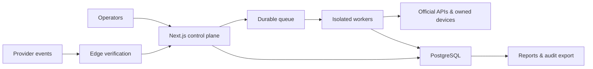
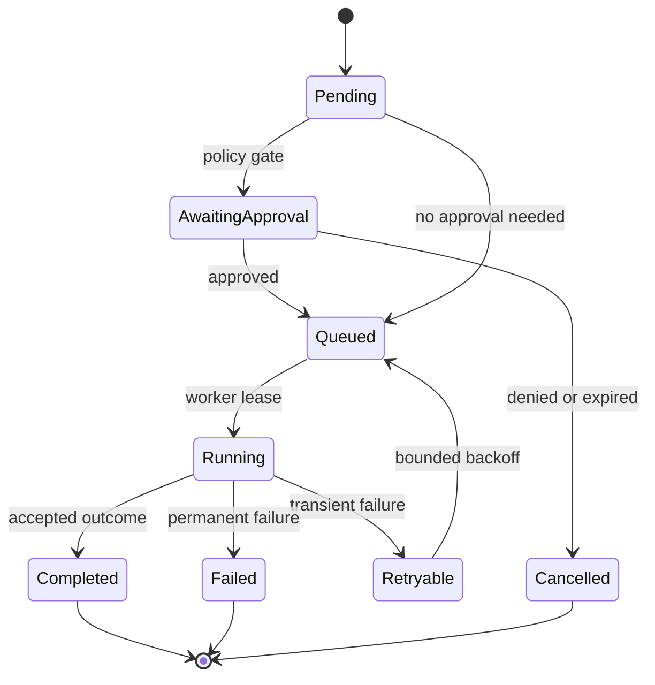

# ACoolPHONE Architecture

## Decision summary

ACoolPHONE is a multi-tenant control plane. It coordinates authorized channels, company-controlled devices, provider adapters, governed workflows, and operational evidence. The web process is not intended to perform long-running device work itself.

## System boundaries

The queue, production workers, provider adapters, and immutable audit export are controlled-pilot work. Their interfaces are represented in the data model and documentation; they are not falsely presented as deployed in this foundation release.

## Request path

1. The edge terminates TLS, enforces body and rate limits, and removes any untrusted internal tenant headers.
2. The application resolves hostname/subdomain to a candidate tenant.
3. Authentication identifies the actor.
4. Authorization confirms active membership and permission inside that tenant.
5. The application performs a tenant-scoped read or write.
6. High-impact actions create an approval request instead of dispatching directly.
7. Accepted work enters a durable queue with an idempotency key.
8. A bounded worker obtains a short-lived provider credential, performs the operation, and records the result.
9. An audit event records actor, action, resource, outcome, and safe metadata.

Steps 3–8 are launch-gate work where the current repository does not yet implement them.

## Data ownership

- Every operational record is associated with one tenant.
- A tenant header or hostname selects context but never grants access.
- Provider credentials remain outside PostgreSQL. `integrations.credential_ref` points to a secret-manager entry.
- Provider billing remains financially authoritative. `subscriptions` mirrors operational state and limits.
- Webhook payload retention must be minimized because raw provider events can include personal data.

## Execution model

The intended task state machine is:

The current `automation_tasks` schema is a foundation for this model. A pilot should add explicit attempt, lease, approval, idempotency, and dead-letter records rather than overloading a free-form payload.

## Deployment profiles

### Web-first preview

- Next.js on Vercel or Cloud Run
- Managed PostgreSQL
- No production provider adapter
- Public sales site and demonstration console

### Controlled pilot

- Edge gateway/WAF
- Next.js control plane
- Managed PostgreSQL with backups and encrypted transport
- Managed queue and dead-letter queue
- Private worker service
- Secret manager/KMS
- Centralized telemetry and alerting
- One accepted provider adapter

### Enterprise operation

- SSO/SCIM and granular policy
- Residency-aware topology where contracted
- Immutable audit export
- Disaster recovery objectives and restore exercises
- Formal change, incident, vulnerability, and access-review processes

## Architecture decisions still required

| Decision | Why it cannot be assumed |
|---|---|
| Identity provider | Depends on client/workspace requirements and SSO needs |
| Queue/worker platform | Depends on deployment target, throughput, latency, and device topology |
| Row-level security approach | Depends on connection pooling and authorization design |
| Provider adapter priority | Must be chosen by a real pilot with account authority |
| Data retention | Depends on data classes, contracts, and applicable rules |
| Region and recovery objectives | Depend on residency and business continuity requirements |
